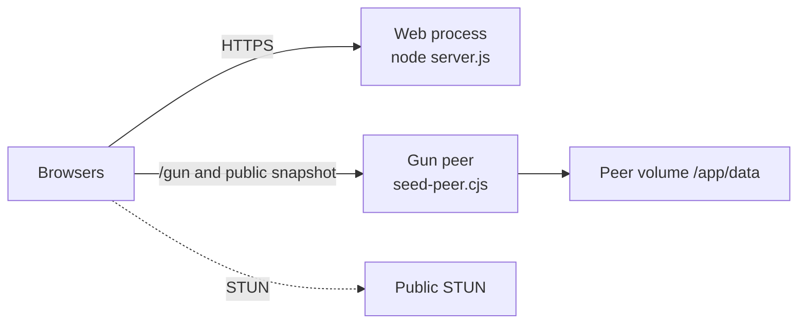
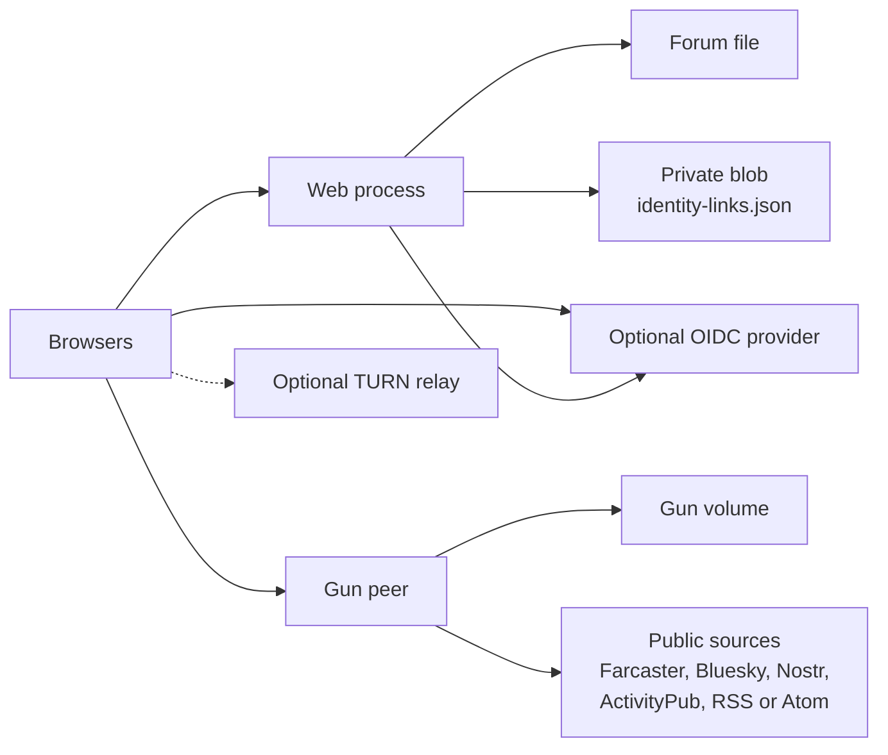
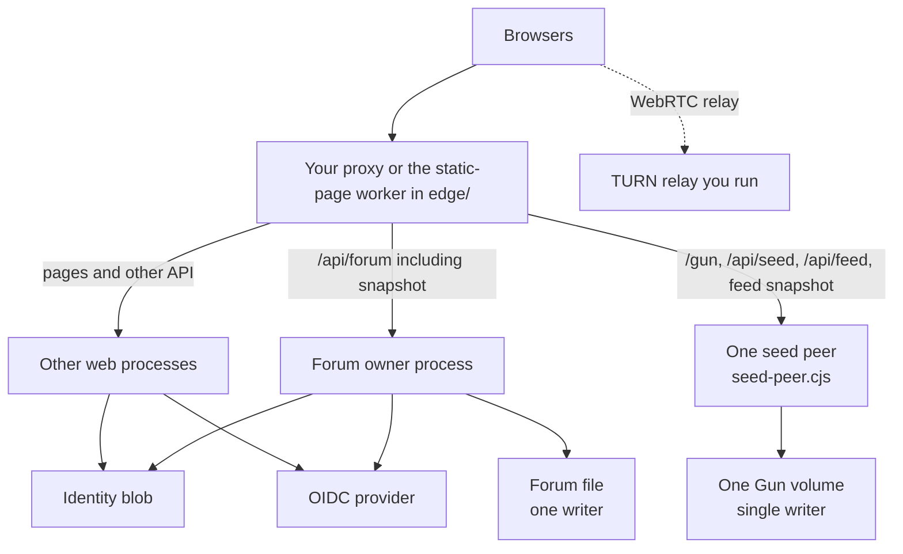

# Deploying s3r.ch

Three ways to run this repository. Each one uses only components, settings, and dependencies that the code, the `Dockerfile`, and [configuration.md](configuration.md) already define. Anything this process does not do is marked **planned** or **not supported**.

## Which image to run

A running service follows a version tag and picks up patches on that line. Services are patch-compatible within a minor version.

- TEST uses `ghcr.io/fyberlabs/s3r.ch:test`. That name advances when a new build is published.
- A production copy uses the minor line, for example `ghcr.io/fyberlabs/s3r.ch:1.4`. A new patch in that minor version moves the tag. Each code change is a new patch version. A downloadable package is named by that version.

A digest may be recorded to verify which image a tag resolved to. It is not how you deploy. How those tags are published is [release.md](release.md).

A Node checkout of the same `Dockerfile` is [install-minimal.md](install-minimal.md).

The image listens on port 8080, runs as uid 1001 (`nextjs`), and declares `VOLUME /app/data`. The default command is `node server.js`, the web process. Gun is a second process from the same image: `node /app/seed-peer.cjs`. `GET /api/health` returns HTTP 200 while the process is up. The web process reports `dependencies.gun.status` as `external`. The peer reports Gun as `ok`. `GET /api/version` returns the build revision when `APP_BUILD_REVISION` is a 40-character commit id.

This repository does not publish CPU or memory sizes. The constraint that is in the code: one process writes a given `GUN_FILE` directory.

## What every scenario shares

| Piece | Where it comes from |
| --- | --- |
| Web app | This image, command `node server.js`. It does not attach Gun. Its `/api/seed` route answers 503 and tells the caller to use the peer. |
| Gun peer | Same image, command `node /app/seed-peer.cjs`. Serves `/gun`, `/feed-cache/snapshot.json`, `GET /api/feed`, and `POST /api/seed`. One writer for its Gun volume. |
| Gun data | `GUN_FILE`, default `/app/data/radata` in the image. |
| Public snapshot | `GUN_SNAPSHOT`, default `/app/data/snapshot.json`. Served at `/feed-cache/snapshot.json`. |
| Forum ledger | `S3RCH_FORUM`, default `/app/data/forum.json`. |
| Session secret | `IDENTITY_SESSION_SECRET`, at least 32 characters. Required in production. |
| Browser mesh key | Created in the visitor's browser after sign-in. It is not on the server disk. |
| STUN | `stun:stun.l.google.com:19302` in the browser. STUN is not a relay. |

Related repositories:

- This app: [FyberLabs/s3r.ch](https://github.com/FyberLabs/s3r.ch)
- Permission contract. This app reimplements a light check in the browser and does not import the crate: [FyberLabs/SociACL](https://github.com/FyberLabs/SociACL)
- Hypermesh account notes: [FyberLabs/hypermesh-docs](https://github.com/FyberLabs/hypermesh-docs)
- Gun: [amark/gun](https://github.com/amark/gun)
- Production hosting for s3r.ch itself is described in [FyberLabs/infra `terraform/s3rch`](https://github.com/FyberLabs/infra/blob/main/terraform/s3rch/README.md). That tree is how this project is hosted. It is not required to run your own copy.

## Minimal: one web process and one Gun peer

The web process serves the site and the forum. The Gun peer is a second container from the same image, with its own volume. Wallet sign-in on the production image answers 503 until the identity document settings in the next section are set. A Node process with `NODE_ENV` unset stores that document in a local file instead (`S3RCH_IDENTITY_LINKS`, default `data/identity-links.json`).



Components:

- The s3r.ch web container.
- The s3r.ch peer container, volume at `/app/data`, writable by uid 1001.
- A proxy that sends `/gun`, `/feed-cache/snapshot.json`, `/api/feed`, and `/api/seed` to the peer, and the rest of the site to the web process.
- Public STUN from the browser. No relay.

A running test installation:

```bash
docker run --rm -p 8080:8080 \
  -e IDENTITY_SESSION_SECRET \
  ghcr.io/fyberlabs/s3r.ch:test

docker run --rm -p 8081:8080 \
  -e SEED_SECRET \
  -v s3rch-data:/app/data \
  ghcr.io/fyberlabs/s3r.ch:test \
  node /app/seed-peer.cjs
```

For a production minor line, use `ghcr.io/fyberlabs/s3r.ch:1.4` in place of `:test` on both commands. The same tag on the web process and the peer picks up later patches together. Details are in [release.md](release.md).

Set `IDENTITY_SESSION_SECRET` in the shell first. Then:

```bash
curl -sS http://127.0.0.1:8080/api/health
curl -sS http://127.0.0.1:8081/api/health
```

The web process on port 8080 reports Gun as `external`. The peer on port 8081 reports Gun as `ok`. With the identity document unset, `dependencies.identity.status` becomes `unavailable` and sign-in answers 503. Replacing the peer container without its volume drops Gun data and the public snapshot. The forum file is on the web process. In this minimal command that disk is inside the web container, so replacing that container drops the forum file too.

`POST /api/seed` fills the public snapshot from Farcaster, Bluesky, Nostr, ActivityPub, and RSS or Atom. In production the call requires `Authorization: Bearer` matching `SEED_SECRET`. An empty source writes nothing.

Not in this scenario: a second web process, account sign-in, a TURN relay, outbound Farcaster or Bluesky, or a shared identity document. Those are the next section, or **not supported** where the enterprise section says so.

## Typical: production with the dependencies the app actually calls

One web process, one Gun peer, plus the stores and optional doors the server already implements.



Components:

- Everything in the minimal scenario.
- A private Azure Blob container for the identity document. The production image does not read the local identity file. Settings: `S3RCH_IDENTITY_BLOB_ACCOUNT` and `S3RCH_IDENTITY_BLOB_CONTAINER`. The blob name is `identity-links.json`. Auth is the process managed identity (`DefaultAzureCredential`). A user-assigned identity also needs `AZURE_CLIENT_ID`. That identity needs Storage Blob Data Contributor on the account or the container. The container must already exist. The app does not create it. There is no storage connection string.
- `SEED_SECRET` if you call `/api/seed`.
- Optional account sign-in. `S3RCH_OAUTH_ISSUER` adds the default provider, or `S3RCH_LOGIN_PROVIDERS` replaces the provider list with a JSON array that still includes the wallet entry. Endpoints default to the Keycloak layout under the issuer. Another provider can set `authorizationEndpoint`, `tokenEndpoint`, and `jwksUri`. The client is public PKCE. Default client id is `s3rch-web`. No client secret. When the default provider is configured, the sign-in page offers Microsoft, GitHub, Google, and Hypermesh. Wallet hostnames are `ALLOWED_SIWE_HOSTS` and OAuth redirect URIs are `OAUTH_REDIRECT_URIS`, both in `lib/identity/config.ts`. A hostname that is not on those lists cannot finish sign-in. Adding one is a code change, not a setting. That is **not supported** by configuration today.
- Optional TURN you run. `S3RCH_TURN_URLS` plus `S3RCH_TURN_SECRET` (the same value as coturn `static-auth-secret`). Signed-in `POST /api/turn/allocate` mints a short-lived REST credential. Unset, the route returns 503 and browsers stay on STUN plus `/gun`. The steps and a coturn example are in [install-minimal.md](install-minimal.md#turn).
- Optional remote attest, payments, and TURN-allocate hops. With their settings unset, those routes return 503 and the site still serves. The setting names are in [configuration.md](configuration.md). This repository does not deploy those services.
- Optional outbound posts. `FARCASTER_FID` and `FARCASTER_SIGNER_KEY` for Farcaster. `ATPROTO_IDENTIFIER` and `ATPROTO_APP_PASSWORD` for Bluesky (`ATPROTO_PDS_BASE` defaults to `https://bsky.social`). Missing credentials fail closed. ActivityPub and Nostr outbound are **coming in v1** and are not wired.
- Optional build argument `NEXT_PUBLIC_WC_PROJECT_ID`. Empty leaves WalletConnect out of the image. Injected wallets and the passkey wallet still sign in.
- Optional `UNSTOPPABLE_API_KEY` for a name lookup. Empty keeps the on-chain lookup only.
- Optional `CONFIRM_SEND_URL` for email and phone confirmation, and `KYC_ISSUER_URL` for a confirmation issuer. Empty leaves those sends unconfigured.

```bash
docker run --rm -p 8080:8080 \
  -e IDENTITY_SESSION_SECRET \
  -e S3RCH_IDENTITY_BLOB_ACCOUNT \
  -e S3RCH_IDENTITY_BLOB_CONTAINER \
  -e AZURE_CLIENT_ID \
  -v s3rch-forum:/app/data \
  ghcr.io/fyberlabs/s3r.ch:1.4
```

That volume is the forum file on the web process. The Gun peer keeps the separate volume from the minimal section, and it is the process that receives `SEED_SECRET`. Use the same minor tag on the peer. A running test installation uses `ghcr.io/fyberlabs/s3r.ch:test` on both. Pass `AZURE_CLIENT_ID` only for a user-assigned identity. Give the web process a managed identity that can write the container. Do not put secrets in the image.

Check `GET /api/health` on the web process and on the peer. `dependencies.identity.status` is `ok` on the web process when the blob check passes. The web process reports Gun as `external`. The peer reports Gun as `ok`. A failed identity store does not take down the feed, the forum, or `/gun`.

Backup, from [install-minimal.md](install-minimal.md#backup-and-restore). Stop writers first.

- Copy the `GUN_FILE` directory, `GUN_SNAPSHOT`, and the forum file. Restore them to the same paths, then start one process.
- Copy the blob `identity-links.json`. Upload it back to the same blob name to restore. A document the app cannot parse is not overwritten.
- Copying the server disk does not copy the browser's SEA key.

This repository does not run a backup scheduler. The copies above are the backup.

## Full enterprise

High availability, directory sign-in, an edge in front of the app, monitoring, and backups. Only the rows marked supported are in this repository.



### Supported

**Gun peer.** The image includes `node /app/seed-peer.cjs`. That process serves `/gun`, `/feed-cache/snapshot.json`, `GET /api/feed`, `POST /api/seed`, and `GET /api/health`. Give it `SEED_SECRET` and its own writable Gun volume. The web process is `node server.js`. It does not attach Gun, and its health reports `dependencies.gun.status` as `external`. Route `/gun`, `/feed-cache/snapshot.json`, `/api/feed`, and `/api/seed` to the peer. Identity cookies stay on the web origin.

**More than one web process**, behind a proxy you run, when every process uses the same identity blob and the same `IDENTITY_SESSION_SECRET`. The session is a signed cookie, so it does not stick to one process. This repository does not ship the proxy. `/api/forum` does not follow that spread. See the forum step below.

**Directory sign-in.** `S3RCH_LOGIN_PROVIDERS` is the list. Include the wallet entry. Each OpenID Connect entry is public PKCE, issuer pinned on first success. Details: [install-minimal.md](install-minimal.md#login-providers) and [oauth-idp.md](oauth-idp.md).

**TURN.** A relay with a public name, UDP, and `S3RCH_TURN_SECRET`, as in the typical scenario. This image is not the relay. A remote allocate hop is optional and stays unconfigured until its settings are present. See [configuration.md](configuration.md).

**Edge for prerendered pages.** `edge/public-pages.mjs` serves exported HTML and static files, and forwards `/api`, `/gun`, `/feed-cache`, WebSocket upgrades, and router requests to the origin. `npm run build` writes the export. The checked-in worker config is not a deployment for other organizations. You can run that worker in front of your own origin. This repository does not operate it for you.

**Monitoring.** Poll `GET /api/health` (always HTTP 200; read `dependencies`) and `GET /api/version`. The image `HEALTHCHECK` calls `/api/health`. There is no metrics endpoint and no trace exporter in this repository.

**Backups.** The same copies as the typical scenario: Gun directory, snapshot, forum file, and the identity blob. Stop the single Gun writer and the forum writer before the copy. There is no backup scheduler in this repository.

### Not supported

- Two processes writing the same `GUN_FILE`. The second writer will corrupt that directory.
- Sharing one `S3RCH_FORUM` file across web processes, or sending `/api/forum` to more than one of them. The forum ledger is a local JSON file. A process that does not have that file opens an empty forum. A highly available forum is **planned**. Until then, one process owns the file and every forum request goes to that process.
- Active-active Gun across regions, or a clustered Gun datastore. **Not supported.** One seed peer owns one volume.
- Sign-in on a hostname that is not in `ALLOWED_SIWE_HOSTS` or `OAUTH_REDIRECT_URIS` (`lib/identity/config.ts`). **Not supported** until that code changes.
- A packaged production edge, a metrics pipeline, or a backup scheduler. **Not included.** The health routes and the copy steps above are what this repository provides.
- Automated failover of the seed peer. **Planned.** You can restore the Gun volume onto a new single peer and point the proxy at it.

### Config steps for this shape

1. Run one `seed-peer.cjs` with `SEED_SECRET` and a volume for `GUN_FILE` and `GUN_SNAPSHOT`.
2. Run web processes with the image default `node server.js`, `IDENTITY_SESSION_SECRET`, and the two identity blob settings. Point every web process at the same blob.
3. Route `/gun`, `/feed-cache/snapshot.json`, `/api/feed`, and `/api/seed` to the seed peer. Keep identity cookies on the web origin.
4. Route every `/api/forum` request, including `GET /api/forum?snapshot=<handle>`, to the one web process that owns the forum file. Mount that file only on that process. Mounting the volume is not enough: `app/api/forum/route.ts` calls `getForum()` on whichever process receives the request, and a missing file is an empty forum. Posts, invites, and groups then differ between processes.
5. Route the rest of the site across the web processes.
6. Add `S3RCH_LOGIN_PROVIDERS` for directory sign-in, and `S3RCH_TURN_URLS` plus `S3RCH_TURN_SECRET` if you run a relay.
7. Poll `/api/health` on the web processes and on the seed peer. Copy the Gun volume, the forum file, and the identity blob on a schedule you run yourself.

Leave optional integration settings unset unless you run those services. The site still serves.
